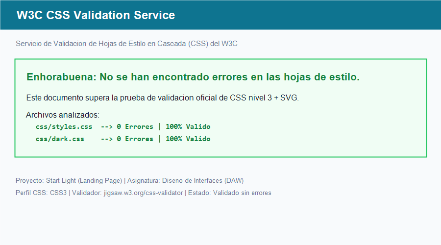

# Práctica: Landing Page - Start Light

**Asignatura:** Diseño de Interfaces Web  
**Curso:** Desarrollo de Aplicaciones Web (DAW)  
**Autor:** Juanma, Carlos Navarro y Bakunin  

---

## Descripción del Proyecto
Implementación de la página principal (*landing page*) para **Start Light**, un servicio de conectividad satelital de alta velocidad y baja latencia.

El proyecto parte del diseño inicial y boceto realizado en equipo durante la **UT1** (Opción A), aplicando maquetación con **HTML5 semántico**, framework **Bootstrap 5** para la estructura adaptativa (*responsive*) y personalización con **CSS3**.

---

## Estructura del Repositorio
El proyecto sigue estrictamente la organización de directorios solicitada:

```text
DISENO_INTERFACES/
│
├── index.html                  # Página principal de la landing page
├── README.md                   # Documentación de la práctica
│
├── css/
│   ├── styles.css              # Hoja de estilos externa principal (Modo Claro / Predeterminado)
│   └── dark.css                # Hoja de estilos alternativa (Modo Oscuro)
│
└── img/
    ├── boceto-ut1.png          # Boceto de estructura y distribución diseñado en  el prototipo. 
    └── validador-w3c.png       # Captura de pantalla de la validación CSS del W3C sin errores
```

---

## Justificación Técnica de los Requisitos

### 1. Uso y Jerarquía de Estilos CSS3 (Demostración de Especificidad)
Se han implementado y documentado con comentarios los tres niveles de cascada:

1. **Hoja Externa (`css/styles.css`):** Contiene todas las reglas de diseño, variables de color, maquetación de la órbita, tarjetas y pie de página.
2. **Estilo Interno (`<style>` en `<head>`):** Se ha definido una personalización tipográfica y renderizado global sobre el elemento `body`.
3. **Estilo en Línea (`style="..."`):** Aplicado en el distintivo superior (*badge* del encabezado) modificando su color a tono ámbar. Este estilo demuestra de forma práctica en el navegador cómo la mayor especificidad del estilo en línea sobrescribe los valores definidos en la hoja externa.

---

### 2. Personalización y Reescritura de Bootstrap 5
Se han adaptado componentes del framework para otorgar una identidad visual propia:
* **Botones:** Creación de la clase propia `.btn-principal` con bordes redondeados y transiciones suaves al interactuar.
* **Formularios:** Sobrescritura de `.form-control` mediante `.input-personalizado` para mantener la estética uniforme tanto en modo claro como en oscuro.
* **Tipografía:** Vinculación de la fuente **Outfit** de Google Fonts para unificar el texto en toda la interfaz.
* **Navbar y Grid:** Uso de la rejilla responsive de Bootstrap (`container`, `row g-4`, `col-12 col-md-6 col-lg-4`) y menú colapsable mediante `navbar-toggler`.

---

### 3. Tema Alternativo: Modo Oscuro (`css/dark.css`)
* Se ha creado la hoja alternativa `css/dark.css` que redefine las variables de color hacia una paleta oscura espacial (fondo `#0a0d1a`, tarjetas `#111827`, texto claro `#f1f5f9` y acentos cian/morado neón).
* **Conmutador interactivo:** En el menú de navegación se incluye un botón (`🌙 Modo Oscuro / ☀️ Modo Claro`) que activa o desactiva la hoja alternativa de manera instantánea, permitiendo comprobar ambos temas con un solo clic.

---

### 4. Diseño Adaptativo (Responsive)
La web ha sido verificada en las herramientas de desarrollo (*DevTools*) simulando dispositivos móviles y tablets:
* El menú colapsa en un botón desplegable en pantallas pequeñas.
* La rejilla de tarjetas pasa de 3 columnas (escritorio) a 2 columnas (tablets) y 1 columna fluida (móviles).
* El componente de la órbita satelital se escala proporcionalmente mediante *media queries* para evitar cualquier desbordamiento horizontal en pantallas estrechas.

---

### 5. Validación W3C
Las hojas de estilo `css/styles.css` y `css/dark.css` se han comprobado con el validador oficial del W3C ([W3C CSS Validation Service](https://jigsaw.w3.org/css-validator)), obteniendo una validación limpia sin errores críticos de sintaxis. La evidencia gráfica se encuentra en `img/validador-w3c.png`.


---

##  Instrucciones para Visualizar el Proyecto
1. Clonar o descargar el repositorio.
2. Abrir el archivo `index.html` en cualquier navegador web moderno (Chrome, Firefox, Edge).
3. Hacer clic en el botón superior **Modo Oscuro** para alternar entre el tema claro predeterminado y el tema oscuro.

